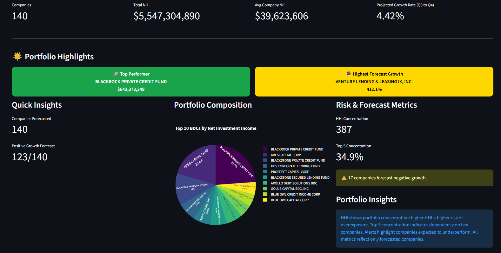

# BDC Net Investment Income Forecasting & Analytics

Forecasting quarterly **Net Investment Income (NII)** for 140 US Business Development Companies from raw SEC filings, with an interactive Streamlit dashboard on top.

Built for the ASU Data Science Capstone (FSE 570, Fall 2025, Prof. Joshua Loughman) by a 5-person team.



---

## What's a BDC?

A Business Development Company is a publicly reporting fund that lends to small and mid-sized US businesses. You can think of BDCs as publicly traded private-credit funds. They file standardized financial data with the SEC every quarter, which is what this project uses.

## What this repo contains

| Part | Folder | What it does |
|---|---|---|
| **NII forecasting dashboard** | `BDC_NII_Dashboard_Project/` | Streamlit app showing NII forecasts, portfolio concentration (HHI, top-5 share), top performers and companies forecast to shrink. Runs on the small CSVs included in the folder. |
| **Data platform** | `src/`, `config.yml` | Loads SEC BDC filings into a DuckDB / Parquet store, builds a quarterly panel per company, engineers features and backtests forecasting models. |
| **Platform dashboard** | `dashboards/` | A second Streamlit app for exploring the panel: per-company trends, portfolio mix, side-by-side comparison and model performance. |
| **Analysis** | `bdc_2022 q4-2023 q4.ipynb`, `notebooks/` | Exploratory analysis and the Prophet forecasting work. |
| **Docs** | `docs/` | Project plan, implementation notes for each phase, and the modeling issues we hit and how we fixed them. |
| **Tests** | `tests/` | pytest tests for ingestion, the DuckDB store and panel/feature building. |

## Results

- Cleaned **1.13M records** from 11 quarters of filings (186 companies, 89K holdings), removing **71K duplicate rows (34%)**.
- Compared **16 model setups** (naive, rolling mean, ridge, XGBoost, LightGBM, random forest) with expanding-window backtests that never train on future quarters.
- None of the ML models beat the simple "repeat last quarter" baseline, so the team moved to **Prophet** for the final forecasts.
- Produced **280 forecasts** with 85% confidence intervals. Median error was **15.4% MAPE in a historical backtest** (scored on quarters the model was fit on, so treat it as in-sample, not a true out-of-sample accuracy).
- Projected industry NII from **$8.36B to $8.73B (+4.4%)** for Q3 to Q4 2025; 123 of 140 companies forecast to grow.

## Quick start: run the NII dashboard

This needs no SEC download. The dashboard reads the four CSVs that ship with it.

```bash
git clone https://github.com/1110shivampatel/bdc_project.git
cd bdc_project/BDC_NII_Dashboard_Project
python -m venv .venv
.venv\Scripts\activate          # macOS/Linux: source .venv/bin/activate
pip install -r requirements.txt
streamlit run Updated_app1.py
```

Run it from inside `BDC_NII_Dashboard_Project/`, because the app loads its CSVs by relative path. It opens at http://localhost:8501.

## Full pipeline: rebuild everything from SEC data

1. **Get the data.** Download the quarterly or monthly ZIPs from the [SEC BDC Data Sets](https://www.sec.gov/data-research/sec-markets-data/bdc-data-sets) page and unzip each one into its own folder under `data/raw/`, for example `data/raw/2025_Q1/`.
2. **Install dependencies** from the project root:
   ```bash
   pip install -r requirements.txt
   ```
3. **Run the pipeline**, in order:
   ```bash
   python -m src.data.ingest                 # manifest of raw files with hashes
   python -m src.data.build_store            # load into DuckDB + Parquet
   python -m src.data.panel                  # one row per BDC per quarter
   python -m src.features.feature_engineering
   python -m src.models.train                # backtest and compare models
   python -m src.models.predict              # write forecasts
   ```
4. **Open the platform dashboard:**
   ```bash
   python scripts/run_dashboard.py
   ```
5. **Run the tests:**
   ```bash
   pytest
   ```

Paths and model settings live in `config.yml`.

## Data

The data comes from the SEC's public [BDC Data Sets](https://www.sec.gov/data-research/sec-markets-data/bdc-data-sets), which are extracted from XBRL filings "as filed" by each company. **The raw and processed data are not included in this repo**: together they are about 3 GB, and the DuckDB store alone is around 400 MB. Follow step 1 above to download them. The only data committed here is the small set of derived CSVs the NII dashboard needs.

## Tech stack

Python, pandas, NumPy, DuckDB, Parquet (PyArrow), Prophet, scikit-learn, XGBoost, LightGBM, Streamlit, Plotly, pytest

## Project structure

```
bdc_project/
├── BDC_NII_Dashboard_Project/   # NII forecasting dashboard + its CSVs
├── dashboards/                  # platform dashboard (Streamlit)
├── docs/                        # plan, phase notes, images
├── notebooks/                   # exploratory notebooks
├── scripts/                     # run_dashboard.py, verify_phase2.py
├── src/
│   ├── data/                    # ingest, DuckDB store, quarterly panel
│   ├── features/                # feature engineering + target labels
│   ├── models/                  # baselines, ML models, backtesting, predict
│   └── utils/
├── tests/
├── config.yml
└── requirements.txt
```
